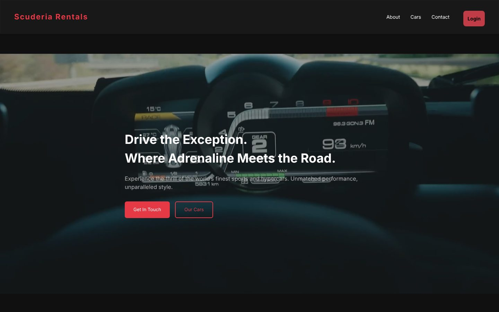

# Scuderia Rentals : interface web

Interface React d'une plateforme de location de voitures de sport : catalogue, réservation avec calendrier, espace client et panneau d'administration des demandes.


**Démo en ligne :** [scuderiacarrentals.vercel.app](https://scuderiacarrentals.vercel.app)

**API utilisée :** [scuderiarentals](https://github.com/medazero01-art/scuderiarentals) (Node.js, Express, MongoDB)



## Fonctionnalités

- **Catalogue** des véhicules chargé depuis l'API, avec squelettes de chargement
- **Réservation** dans une fenêtre dédiée : le calendrier (`react-datepicker`) grise les dates déjà validées pour le véhicule choisi
- **Inscription et connexion** : le jeton JWT renvoyé par l'API est conservé côté client puis envoyé dans l'en-tête `Authorization`
- **Espace client** : historique de ses réservations et de leur statut
- **Panneau d'administration** : liste de toutes les demandes, validation ou refus en un clic
- **Page contact** avec une carte interactive (Leaflet / OpenStreetMap)
- Page d'accueil avec vidéo en arrière-plan

## Pages

| Route | Contenu |
|---|---|
| `/` | Accueil |
| `/cars` | Catalogue et réservation |
| `/login`, `/register` | Authentification |
| `/profile` | Mes réservations |
| `/admin` | Gestion des demandes de réservation |
| `/about`, `/contact` | Présentation et contact |

## Stack technique

| Rôle | Outils |
|---|---|
| Interface | React 19, Vite |
| Navigation | React Router 7 |
| Dates | react-datepicker, Moment.js |
| Carte | Leaflet, react-leaflet |
| Icônes | react-icons |
| Hébergement | Vercel |

## Installation

**Prérequis :** Node.js 18 ou plus, et l'[API Scuderia Rentals](https://github.com/medazero01-art/scuderiarentals) lancée en local ou en ligne.

```bash
git clone https://github.com/medazero01-art/scuderiarentalsfend.git
cd scuderiarentalsfend
npm install
```

Indiquer l'adresse de l'API dans un fichier `.env` :

```env
VITE_API_BASE_URL=http://localhost:5000/api
```

Puis lancer le serveur de développement :

```bash
npm run dev
```

## Structure

```
src/
├── Components/   # Header, Footer, CarCard (fiche et fenêtre de réservation), Map
├── Pages/        # Home, About, Car, Contact, Login, Profile, Admin
├── assets/       # Images, logos, vidéo d'accueil
├── App.jsx       # Déclaration des routes
└── main.jsx      # Point d'entrée
```

## Auteur

**Ayoub Touat** · [@medazero01-art](https://github.com/medazero01-art)
